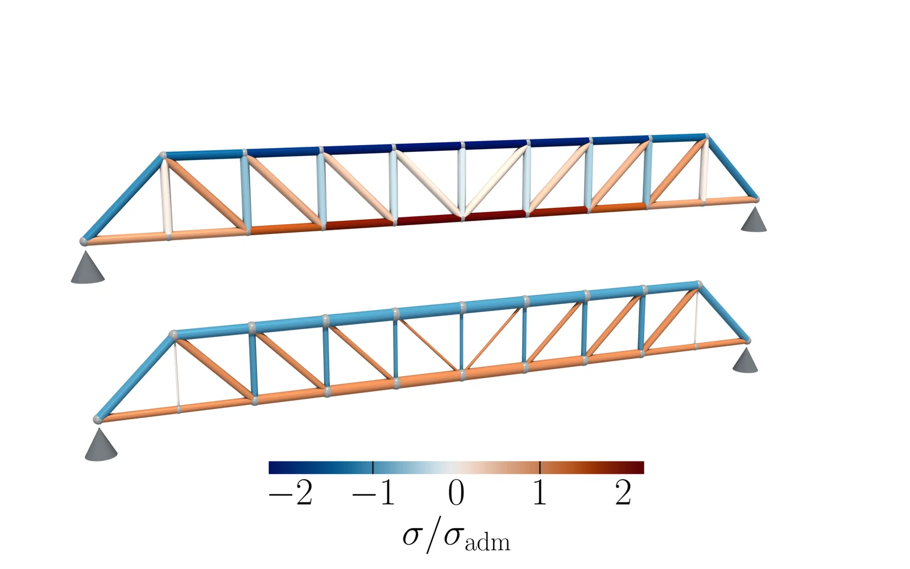

# Truss sizing optimisation

<p align="center">
  <a href="https://doi.org/10.1007/s13296-018-0194-8"></a>
  <a href="https://www.python.org/"></a>
  <a href="https://github.com/EngFlavioMartins/truss-sizing-optimisation/blob/HEAD/LICENSE"></a>
  <a href="https://engflaviomartins.github.io/#work-truss"></a>
</p>

**Minimum-mass sizing of isostatic trusses as one linear programme.**

<p align="center"></p>

In a statically determinate truss, member forces are linear in the member areas, so minimum-mass sizing under stress limits becomes a single linear programme. This is a Python re-implementation of the paper's method; the original 2018 MATLAB code is not available.

## Get started

```bash
git clone https://github.com/EngFlavioMartins/truss-sizing-optimisation.git
cd truss-sizing-optimisation
pip install -r requirements.txt
python examples/truss_37.py
```

This sizes the paper's 37-member benchmark: 13.15 kg (the paper reports 13.35 kg and 13.23 kg). The method lives in [`src/truss_sizing/`](src/truss_sizing/truss.py).

## Make the figure above

```bash
sh scripts/render/make_figure.sh
```

You need [ParaView](https://www.paraview.org/download/) (for `pvpython`), a LaTeX installation, and `pip install pyvista pillow`. The figure compares a uniform truss with the sized one at the same mass.

## Cite

This code re-implements the method of the paper below. If you use it, please cite:

```bibtex
@article{martins2019truss,
  author  = {Martins, Flavio A. C. and Avila, J. P. J. and da Silva, M. A.},
  title   = {A Linear Approach for Sizing Optimization of Isostatic Trussed Structures Subjected to External and Self-Weight Loads},
  journal = {International Journal of Steel Structures},
  volume  = {19},
  number  = {4},
  pages   = {1146--1157},
  year    = {2019},
  doi     = {10.1007/s13296-018-0194-8}
}
```

GitHub's **Cite this repository** button (from [CITATION.cff](CITATION.cff)) gives the same reference in other formats.

## Licence

MIT; see [LICENSE](LICENSE).
