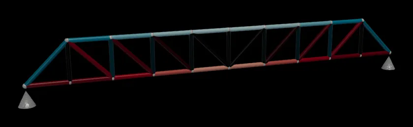

# Truss sizing optimisation

<p align="center">
  <a href="https://doi.org/10.1007/s13296-018-0194-8"></a>
  <a href="https://www.python.org/"></a>
  <a href="https://github.com/EngFlavioMartins/truss-sizing-optimisation/blob/HEAD/LICENSE"></a>
  <a href="https://engflaviomartins.github.io/#work-truss"></a>
</p>

**Minimum-mass sizing of isostatic trusses as one linear programme.**

<p align="center"></p>

In a statically determinate truss the member forces are linear in the member areas, so minimum-mass sizing under stress limits becomes a single linear programme. This is a Python re-implementation of the method in the paper below.

## Run it

```bash
git clone https://github.com/EngFlavioMartins/truss-sizing-optimisation.git
cd truss-sizing-optimisation
python run.py
```

`run.py` sizes the paper's 37-member benchmark truss and prints its mass: 13.15 kg (the paper reports 13.35 kg and 13.23 kg). The first time, it installs what it needs into a private `.venv` folder (a minute or so); after that it starts at once. All you need is Python 3.10 or newer.

<details>
<summary>Prefer conda?</summary>

```bash
conda env create -f environment.yml
conda activate truss-sizing-optimisation
python examples/truss_37.py
```

</details>

**Next:** The method lives in [`src/truss_sizing/`](src/truss_sizing/truss.py); `examples/truss_37.py` shows how to describe your own truss.

## Figure and animation

<p align="center"></p>

The same mass of steel before and after sizing, coloured by stress over admissible stress (teal compression, red tension).

```bash
sh scripts/render/make_figure.sh          # the figure
python scripts/render/make_animation.py   # the animation at the top
```

Both need [ParaView](https://www.paraview.org/download/); the figure also needs LaTeX.

## Cite

This code re-implements the method of the paper below. If you use it, please cite:

```bibtex
@article{martins2019truss,
  author  = {Martins, Flavio A. C. and Avila, J. P. J. and da Silva, M. A.},
  title   = {A Linear Approach for Sizing Optimization of Isostatic Trussed Structures Subjected to External and Self-Weight Loads},
  journal = {International Journal of Steel Structures},
  volume  = {19},
  number  = {4},
  pages   = {1146--1157},
  year    = {2019},
  doi     = {10.1007/s13296-018-0194-8}
}
```

GitHub's **Cite this repository** button (from [CITATION.cff](CITATION.cff)) gives the same reference in other formats.

## Licence

[Apache 2.0](LICENSE): you are free to use, change and share this code, also commercially. If you pass it on, keep the [NOTICE](NOTICE) file with it; it says where the code comes from and how to cite it.
